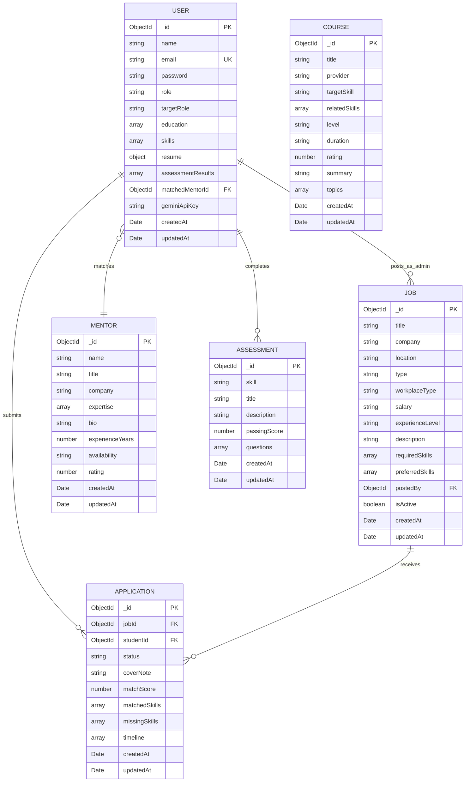

# 🗄️ SkillBridge Database Architecture & Schema Documentation

This document provides a comprehensive technical breakdown of the **MongoDB** database schemas designed using **Mongoose ODM** for the **SkillBridge** platform. It outlines the data model design, field types, constraints, relational mappings (`ref`), embedded subdocuments, pre-save hooks, and indexing considerations.

---

## 🏛️ Entity-Relationship Overview

SkillBridge uses a hybrid data model:
1. **Embedded Subdocuments**: Fast reads and atomic updates for tightly bound data with 1-to-few multiplicity (e.g., student skills, education history, resume details, question options).
2. **Normalized Relational References (`ObjectId` + `ref`)**: Flexible queries and populate joins for many-to-many or 1-to-many relationships (e.g., `User` applying to `Job`, assigning a `Mentor`, or tracking `Application`).



---

## 1. User Schema (`User.js`)
**Collection**: `users`  
**Purpose**: Stores authentication credentials, identity, academic background, skill competencies, embedded ATS resume documents, assessment records, and optional Google Gemini API credentials.

### Field Specification

| Field Path | Type | Constraints & Defaults | Description |
| :--- | :--- | :--- | :--- |
| `name` | `String` | `required: true` | Candidate or Admin full name |
| `email` | `String` | `required: true, unique: true, lowercase: true, trim: true` | Primary identifier for authentication |
| `password` | `String` | `required: true` | Salted and hashed password using bcrypt (10 rounds) |
| `role` | `String` | `enum: ['student', 'admin'], default: 'student'` | Authorization role guard |
| `headline` | `String` | `default: 'Computer Science & Engineering Student'` | Professional headline |
| `bio` | `String` | `default: 'Passionate learner...'` | Personal summary / bio statement |
| `avatar` | `String` | `default: ''` | URL to profile picture or avatar icon |
| `targetRole` | `String` | `default: 'Full Stack Developer'` | Benchmark career role used for skill-gap analysis |
| `geminiApiKey` | `String` | `default: ''` | User's Google Gemini API key for real-time interview grading |
| `matchedMentorId`| `ObjectId` | `ref: 'Mentor', default: null` | Foreign key referencing the matched industry mentor |
| `createdAt` | `Date` | Generated by `timestamps: true` | Account registration timestamp |
| `updatedAt` | `Date` | Generated by `timestamps: true` | Profile last modified timestamp |

### Embedded Subdocuments

#### `education` Array
```javascript
education: [{
  degree: { type: String },       // e.g., 'B.Tech in Computer Science'
  institution: { type: String },  // e.g., 'National Institute of Technology'
  year: { type: String },         // e.g., '2022 - 2026'
  grade: { type: String }         // e.g., '8.8 CGPA'
}]
```

#### `skills` Array (Skill Inventory & Verification)
```javascript
skills: [{
  name: { type: String },
  level: { type: String, enum: ['Beginner', 'Intermediate', 'Advanced'], default: 'Intermediate' },
  verified: { type: Boolean, default: false } // Automatically flipped to true upon passing assessments
}]
```

#### `resume` Subdocument (ATS Profile)
```javascript
resume: {
  title: { type: String, default: 'Master Resume' },
  summary: { type: String, default: '' },
  experience: [{
    role: { type: String },
    company: { type: String },
    period: { type: String },
    description: { type: String }
  }],
  projects: [{
    title: { type: String },
    tech: [String],
    link: { type: String },
    description: { type: String }
  }],
  certifications: [String]
}
```

#### `assessmentResults` Array
```javascript
assessmentResults: [{
  skill: String,
  score: Number,
  total: Number,
  percentage: Number,
  passed: Boolean,
  date: { type: Date, default: Date.now }
}]
```

### Mongoose Middleware & Methods
1. **Pre-Save Hook (`pre('save')`)**: Automatically checks if `password` has been modified. If so, generates a 10-round salt via `bcrypt.genSalt(10)` and securely hashes the password before saving to MongoDB.
2. **Instance Method (`comparePassword`)**: Uses `bcrypt.compare()` to evaluate cleartext passwords on login attempts against the stored hash.

---

## 2. Job Schema (`Job.js`)
**Collection**: `jobs`  
**Purpose**: Represents full-time job openings and student internships, defining required vs. preferred skill requirements for automated candidate match calculation.

### Field Specification

| Field Path | Type | Constraints & Defaults | Description |
| :--- | :--- | :--- | :--- |
| `title` | `String` | `required: true` | Job title (e.g., 'Junior Full Stack Engineer') |
| `company` | `String` | `required: true` | Hiring company or lab name |
| `logo` | `String` | `default: ''` | URL to company logo |
| `location` | `String` | `required: true` | City/Region or 'Remote' |
| `type` | `String` | `enum: ['Full-time', 'Internship', 'Part-time', 'Contract'], default: 'Internship'` | Employment classification |
| `workplaceType` | `String` | `enum: ['Remote', 'Hybrid', 'On-site'], default: 'Remote'` | Physical workplace arrangement |
| `salary` | `String` | `default: '$45,000 - $65,000 / yr'` | Salary or stipend range |
| `experienceLevel`| `String`| `enum: ['Junior', 'Mid', 'Senior'], default: 'Junior'` | Experience tier |
| `description` | `String` | `required: true` | Detailed job responsibilities and overview |
| `requiredSkills` | `[String]` | `required: true` | Primary skills mandatory for candidate matching |
| `preferredSkills`| `[String]` | Optional | Bonus skills contributing to enhanced match score |
| `responsibilities`| `[String]`| Optional | Bulleted list of duties |
| `postedBy` | `ObjectId` | `ref: 'User'` | Admin/Recruiter user ID who published opening |
| `isActive` | `Boolean` | `default: true` | Soft-deletion flag |
| `deadline` | `Date` | Optional | Application expiration date |

---

## 3. Application Schema (`Application.js`)
**Collection**: `applications`  
**Purpose**: Manages job applications connecting a `studentId` with a `jobId`. Stores the AI compatibility score snapshot calculated at application time and tracks milestone progression.

### Field Specification

| Field Path | Type | Constraints & Defaults | Description |
| :--- | :--- | :--- | :--- |
| `jobId` | `ObjectId` | `ref: 'Job', required: true` | Foreign reference to the targeted Job posting |
| `studentId` | `ObjectId` | `ref: 'User', required: true` | Foreign reference to the applicant |
| `status` | `String` | `enum: ['Submitted', 'Under Review', 'Skill Assessment', 'Interview Scheduled', 'Offered', 'Rejected'], default: 'Submitted'` | Current stage in the recruitment pipeline |
| `coverNote` | `String` | `default: ''` | Personal statement or cover note from student |
| `matchScore` | `Number` | `default: 0` | Compatibility score (0–100%) at time of apply |
| `matchedSkills` | `[String]` | Array | Overlapping skills verified in user's profile |
| `missingSkills` | `[String]` | Array | Skills required by job that applicant lacked |

### Embedded `timeline` Subdocument Array
Tracks each step of the candidate's hiring progress with audit history:
```javascript
timeline: [{
  status: String,              // e.g., 'Submitted', 'Under Review'
  note: String,                // e.g., 'Applied with 75% Skill-Match readiness'
  date: { type: Date, default: Date.now }
}]
```

---

## 4. Course Schema (`Course.js`)
**Collection**: `courses`  
**Purpose**: Catalogs structured curriculum modules, learning tracks (including Stanford CS224N and MIT OCW), and maps target skills for automated gap-closing recommendations.

### Field Specification

| Field Path | Type | Constraints & Defaults | Description |
| :--- | :--- | :--- | :--- |
| `title` | `String` | `required: true` | Name of the course track |
| `provider` | `String` | `required: true` | Academic institution or academy (e.g., 'Stanford Online', 'MIT OCW') |
| `thumbnail` | `String` | `default: ''` | Card preview image URL |
| `targetSkill` | `String` | `required: true` | Primary skill bridged (e.g., 'Tokenization', 'Node.js', 'Docker') |
| `relatedSkills` | `[String]` | Array | Secondary technologies touched upon |
| `level` | `String` | `enum: ['Beginner', 'Intermediate', 'Advanced'], default: 'Beginner'` | Course difficulty level |
| `duration` | `String` | `default: '12 hours'` | Estimated completion time |
| `modulesCount` | `Number` | `default: 6` | Number of lecture modules |
| `rating` | `Number` | `default: 4.8` | Student feedback rating (out of 5.0) |
| `url` | `String` | `default: '...'` | Resource or video link |
| `summary` | `String` | `required: true` | Brief syllabus summary |
| `topics` | `[String]` | Array | List of lecture titles or concept names |

---

## 5. Mentor Schema (`Mentor.js`)
**Collection**: `mentors`  
**Purpose**: Stores profiles of senior engineers and tech leaders available for 1-on-1 industry guidance and portfolio reviews.

### Field Specification

| Field Path | Type | Constraints & Defaults | Description |
| :--- | :--- | :--- | :--- |
| `name` | `String` | `required: true` | Mentor full name |
| `title` | `String` | `required: true` | Job title (e.g., 'Principal Staff Engineer') |
| `company` | `String` | `required: true` | Employer (e.g., 'Stripe', 'Linear') |
| `avatar` | `String` | `default: ''` | Profile picture |
| `expertise` | `[String]` | Array | Core tech stack domains (e.g., `['Node.js', 'Docker', 'Distributed Systems']`) |
| `bio` | `String` | `required: true` | Professional background and coaching bio |
| `experienceYears`| `Number` | `default: 5` | Total years of industry experience |
| `availability` | `String` | `default: '4 slots this week'` | Booking status text |
| `rating` | `Number` | `default: 4.9` | Mentee review rating |
| `sessionsCompleted`| `Number`| `default: 42` | Total career mentoring sessions delivered |

---

## 6. Assessment Schema (`Assessment.js`)
**Collection**: `assessments`  
**Purpose**: Contains skill certification benchmark quizzes. When completed successfully, automatically updates the candidate's `skills.verified` flag in `User`.

### Field Specification

| Field Path | Type | Constraints & Defaults | Description |
| :--- | :--- | :--- | :--- |
| `skill` | `String` | `required: true` | Skill validated (e.g., 'React', 'Node.js', 'Docker') |
| `title` | `String` | `required: true` | Test title |
| `description` | `String` | `default: ''` | Overview of testing criteria |
| `passingScore` | `Number` | `default: 70` | Percentage threshold required to earn verified badge |

### Embedded `questions` Subdocument Array
```javascript
questions: [{
  question: { type: String, required: true },
  options: [{ type: String, required: true }], // 4 multiple choice options
  correctAnswer: { type: Number, required: true }, // Index 0-3 (stripped in client requests)
  explanation: { type: String, default: '' } // Pedagogical explanation revealed post-grading
}]
```

---

## 7. Database Design Rationales

1. **Atomic Skill Updates**: Storing `skills` inside `User` allows single-document updates when completing assessments or adjusting proficiency without multi-collection transactions.
2. **Security by Projection**: The `correctAnswer` in `Assessment` and `password` in `User` use field projections (`-password`, `-questions.correctAnswer`) to prevent leaking answers and password hashes over HTTP APIs.
3. **Application Decoupling**: Rather than embedding applications inside `User` or `Job`, the standalone `Application` collection allows rapid pagination, indexing, and bidirectional status updates by both recruiters and candidates.
4. **Historical Scoring Preservation**: The `Application` schema stores snapshots of `matchScore`, `matchedSkills`, and `missingSkills` as plain arrays at the time of application. If the candidate modifies their profile later, the historical application record remains accurate.
